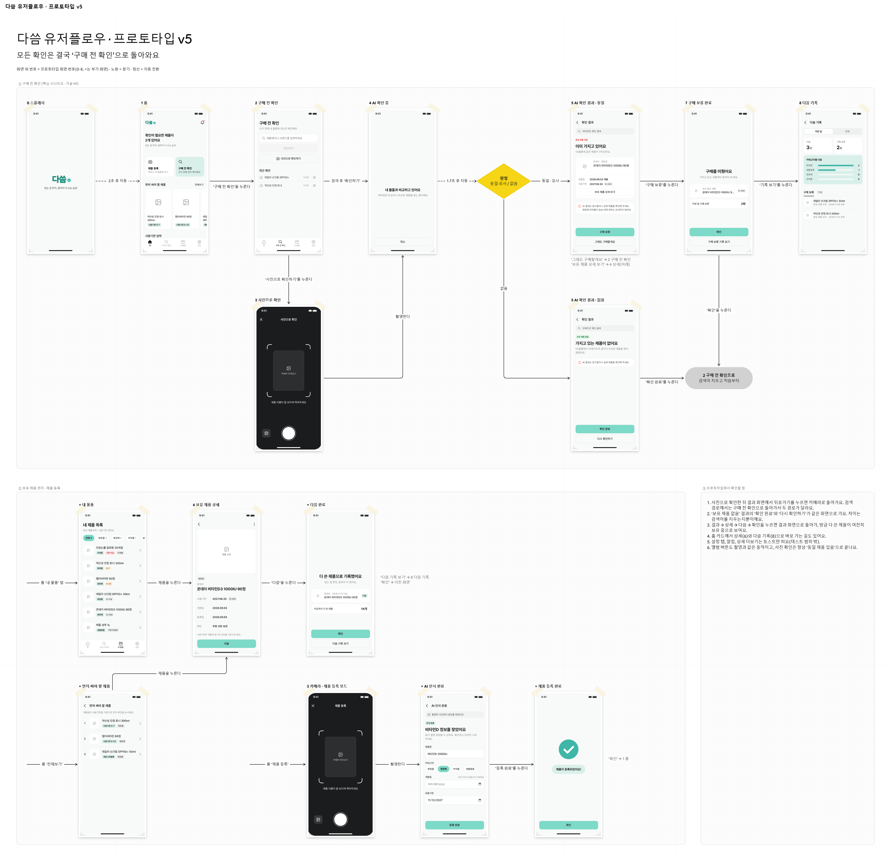

# 다씀 · 디자인 프런트엔드와 유저플로우

사진으로 제품을 등록하고, 구매 전에 이미 보유한 제품인지 확인하는 다씀 앱의 디자인 구현 자료입니다. 사용기간·유통기한 확인과 다씀·구매 보류 기록 흐름을 포함합니다.

이 브랜치는 기존 AI 연동 앱을 유지하면서 **별도 디자인 프런트엔드와 v5 유저플로우 차트**를 추가합니다. 두 앱의 코드는 아직 통합하지 않았습니다.

## 반영 버전: dasseum_app_1113_v1.zip

전달받은 `dasseum_app_1113_v1.zip`의 최신 프런트엔드 코드와 패키지 파일을 `dasseum/`에 반영했습니다. 기존 `dassem/`, `backend/`, 유저플로우 차트 및 Git 연습 문서는 유지합니다. README는 실제 반영 내용과 현재 제한을 설명하도록 별도로 보완했습니다.

### 반영한 변경점

- `react-native-reanimated` 4.7.1 및 `react-native-worklets` 0.13.0 의존성 추가
- 스플래시: 원 확장 → 체크 그리기 → 마침표 위치로 축소·이동 → 로고·슬로건 표시 → 2초 후 홈 이동
- 등록 완료: 체크 도장 확장·그리기 후 완료 문구 표시
- 스플래시와 등록 완료 화면에서 `useReducedMotion`으로 기기의 동작 줄이기 설정 반영
- 토스트의 250ms 페이드 인을 Reanimated로 전환
- `Stamp.tsx`에 체크 선 길이와 공통 이징 정의
- 본문 기본 글자색을 `#171719`로 정리
- 검증 과정에서 토스트의 shared value 갱신을 `.set()`으로 변경하고, 타이머 콜백 ref 갱신을 effect로 옮겨 React 린트 규칙에 맞게 보완

API·DB는 여전히 샘플 데이터 기반이며, 등록 완료 화면에서 제품을 실제 목록에 추가하는 처리는 아직 연결하지 않았습니다. ZIP의 소스 반영과 실제 AI·백엔드 통합은 별도 작업입니다.

ZIP 문서에 언급된 `다씀 프로토타입.html`, `export/dasseum-prototype-v5.html`, `proto/screens.jsx`, `dasseum-gpt-spec.html`은 디자인·개발 기준 문서 이름이며, ZIP 안에는 포함되어 있지 않습니다.

## 브랜치 기준

- 저장소: https://github.com/youngseok1215/alice-dasseum
- 브랜치: `feature/design-v5-frontend-userflow`
- 기반 브랜치: `feature/design-ai-integration`
- 기반 커밋: `4e39c52`

## 폴더 구분

이름이 비슷하므로 실행할 폴더를 확인해 주세요.

| 경로 | 용도 |
| --- | --- |
| `dassem/` | 기존 AI·백엔드 연동 앱. 팀원의 작업을 유지합니다. |
| `backend/` | 기존 Node.js·SQLite 백엔드 |
| `dasseum/` | 이번에 추가한 디자인 프런트엔드. 샘플 데이터로 동작합니다. |
| `dassum_userflow_v5.png` | v5 유저플로우 차트 |

## 유저플로우



[원본 이미지 열기](dassum_userflow_v5.png)

## 디자인 프런트엔드 실행

Node.js와 npm이 설치된 환경에서 저장소를 받은 후 실행합니다. 기존 작업 폴더에 수정 사항이 있다면 먼저 커밋하거나 별도로 보존한 뒤 브랜치를 전환하세요.

```powershell
git clone --branch feature/design-v5-frontend-userflow https://github.com/youngseok1215/alice-dasseum.git alice-dasseum-design
cd .\alice-dasseum-design\dasseum
npm ci
npx.cmd expo start --web
```

휴대폰 실행:

```powershell
npx.cmd expo start
```

터미널의 QR로 실행합니다. Expo Go를 사용하는 경우 프로젝트의 Expo SDK 58과 호환되는 버전이 필요합니다. LAN 연결에서는 PC와 휴대폰이 같은 네트워크에 있어야 합니다. 네이티브 모듈 호환성은 실제 기기에서 확인하세요.

**이 디자인 앱만 확인할 때는 백엔드 실행이나 AI API 키가 필요하지 않습니다.**

## 기술 구성

- Expo SDK 58 / React Native 0.88 / React 19.3
- TypeScript / Expo Router
- AsyncStorage: 최근 확인·개봉·다씀·보류 상태의 기기 내 저장
- React Native SVG: 아이콘과 도장 애니메이션
- 플랫폼별 날짜 입력: 웹 날짜 입력 / 모바일 날짜 피커

## 구현 범위와 현재 제한

| 항목 | 현재 상태 |
| --- | --- |
| 스플래시·홈·목록·상세·기록 | 디자인 화면과 이동 흐름 구현 |
| 제품 등록 | 인식 정보 수정 → 등록 완료 화면 구현. 제품 목록에 실제 추가하는 처리는 미연결 |
| 사진 촬영·앨범 선택 | 디자인 자리표시 및 샘플 화면 이동. 실제 이미지 입력은 미연결 |
| 제품 인식 | 샘플 비타민D 정보를 표시 |
| 동일·유사 판정 | 키워드 규칙. 실제 보유 상태·AI 판정과 아직 연동하지 않음 |
| 개봉·다씀·구매 보류 | 로컬 상태 변경·저장 구현 |
| 홈 추천·임박 목록 | 고정 샘플 ID 사용. 다씀 상태와의 일관성 보완 필요 |
| 기간·통계 | 기준일 2026-11-12 및 일부 고정 수치 사용 |
| 설정·푸시 알림·수정/삭제 | 안내 토스트만 표시 |

디자인 앱의 로컬 저장은 서버 DB와 별개이며 기기 간 공유되지 않습니다. 실제 AI·사진 저장 기능은 기존 `dassem/`·`backend/`와 통합할 작업입니다.

## 확인 시나리오

1. 홈 → 구매 전 확인 → `비타민D`: 동일 제품 결과
2. `온데이 비타민D3 2000IU`: 유사 제품 결과
3. `오메가3`: 보유 제품 없음 결과
4. 사진으로 확인: 샘플 동일 제품 결과
5. 결과 → 구매 보류 → 보류 완료 → 기록
6. 내 물품 → 상세 → 오늘 개봉했어요 / 다씀 → 완료·기록
7. 홈 → 제품 등록 → 인식 정보 수정 → 등록 완료 화면

7번은 현재 화면 시연 단계이며, 저장된 제품이 목록에 추가되는 완료 기준은 아직 충족하지 않습니다.

## 검사

`dasseum/`에서 실행합니다.

```powershell
npx.cmd tsc --noEmit
```

최신 코드의 타입 검사와 웹 빌드가 통과했습니다. 린트는 기존 `dassem/`의 ESLint 및 Expo 설정을 재사용해 `dasseum/src`를 검사했으며 오류 없이 통과했습니다. 이 디자인 폴더 자체에는 아직 독립적인 ESLint 설정·의존성이 없습니다. 모바일 실기기 및 애니메이션의 시각 검증은 별도로 진행해야 합니다.

## 다음 통합 작업

1. 디자인 앱의 등록 값을 제품 상태에 반영하고 목록·상세와 연결
2. 다씀 상태를 홈 추천·중복 판정에도 일관되게 반영
3. 날짜와 기록을 기준으로 D-day·통계를 계산
4. 화면과 AI/API 호출을 분리하는 서비스 계층 마련
5. 기존 촬영·AI 인식·사진 저장 기능을 보존하며 화면 단위로 통합

API 키, `.env`, 로컬 DB, 업로드 사진, `node_modules`, `.expo`는 업로드 대상에서 제외합니다. 실제 사용자 데이터와 개발용 샘플 데이터는 구분합니다.

## 상세 문서

화면별 경로, 파일 구성, 디자인 표현 방식은 [디자인 프런트엔드 README](dasseum/README.md)를 참고하세요.
